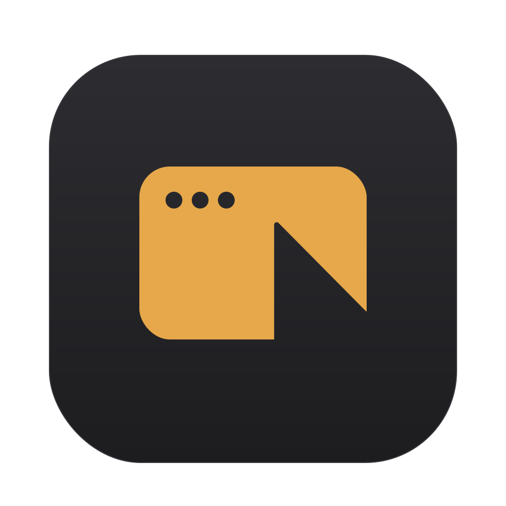

<div align="center">



# FOXmin

**Click any window on your Mac and it just works. One click, like on Windows.**

Free and open source · macOS 13 or newer · Apple Silicon and Intel

[**Download**](../../releases/latest) · [How it works](#how-it-works) · [Install](#install) · [FAQ](#faq) · [☕ Support on Ko-fi](https://ko-fi.com/thevermin)

</div>

> [!NOTE]
> **Yes, FOXmin is vibe-coded.** It was built by describing what I wanted to an AI (Claude) and testing every
> version on my own Mac. [More about that below.](#a-note-on-vibe-coding)

---

## What is FOXmin?

On macOS, the first click on a window that isn't active usually does nothing except activate it. You click a button
in a window behind, and you have to click it again.

The usual fixes use *focus follows mouse*: the window activates when you hover over it. That brings its own problems:
you have to wait for it, and new windows or dialogs (like the Touch ID prompt) don't get focus if your mouse is
somewhere else.

FOXmin fixes it at the root. Focus works exactly like it always does on macOS; only that first click changes:
**one click activates the window and does what you clicked**.

### Why "FOXmin"?
It comes from **focus**, the thing it's all about: say "focus" fast and you get "fox". The *‑min* is family: it's a
sibling of [VRmin](https://github.com/thevermin/VRmin), which plays SteamVR games on a Mac.

## Features

- 🖱️ **One-click windows**: buttons, links, text fields, tabs and title bars in background windows work on the first click
- ✋ **Drag in one move**: drag a background window, or select text in it, without clicking first
- 🖲️ **Right and middle click too** (each one optional)
- 🚫 **Excluded apps**: keep the normal macOS behavior in the apps you choose
- ⏱️ **Activation speed**: give slow apps a little more time to wake up
- 🔄 **Update check**: lets you know when there's a new version
- 🌍 **English and Spanish**: follows your Mac's language
- 🪶 Lives in the menu bar, no Dock icon: **click it to turn FOXmin on or off**, right‑click for the menu

It never touches the menu bar, the Dock, open menus, popovers, the desktop or floating panels.

## How it works

```
 your click
     │
 FOXmin (system-wide event tap, before any app sees it)
     │
     ├─ window already active? ──────────────► click goes through untouched
     │
     └─ window in the background?
            hold the click ─► activate that exact window ─► replay the click (and any drag) in place
```

## Install

1. Download **`FOXmin-<version>.zip`** from [Releases](../../releases/latest) and double‑click it.
2. Drag **FOXmin** to your **Applications** folder.
3. The first time, **right‑click → Open** (macOS warns because the app isn't from the App Store). On newer macOS
   versions, if it still won't open, go to **System Settings → Privacy & Security** and click **Open Anyway**.
4. Give it the **Accessibility** permission when macOS asks. FOXmin starts working as soon as you do.

If you were using a *focus follows mouse* or *auto raise* app, turn it off: FOXmin doesn't need it and they fight
each other.

## Build it yourself

You need Xcode's Command Line Tools (`xcode-select --install`).

```bash
./build.sh            # builds build/FOXmin.app
./build.sh --zip      # also makes the zip for Releases
```

Without a fixed certificate, the app is signed ad‑hoc: every new build looks like a different app to macOS, and the
Accessibility permission may stop working. Sign with your own certificate to avoid it:

```bash
SIGN_IDENTITY="Your certificate" ./build.sh
```

Or reset the permission and grant it again: `tccutil reset Accessibility com.thevermin.foxmin`.

## FAQ

**An app behaves strangely with FOXmin.**
Open the FOXmin menu while that app is in front and choose **Exclude [app]**, or add it from
**Excluded apps → Add app…**. Please also tell us in an [Issue](../../issues).

**Clicks in some app sometimes get lost.**
Try **Activation speed → Patient**. Some apps (often Electron ones) take longer to become active.

**Why isn't it on the Mac App Store?**
To activate a specific window of another app reliably, FOXmin uses private macOS APIs (the same ones projects like
AltTab and yabai use). The App Store doesn't allow that.

**Does it read what I type or click?**
No. It only looks at mouse clicks to know which window is under the pointer, and it never sends anything anywhere.
The only network request is the update check, to GitHub.

## A note on vibe coding

I'll be honest: nobody likes vibe-coded projects, and deep down I'm the first one to hate on them. But sometimes
people need a tool that nobody else is willing to make. That first click that does nothing on a Mac drives me crazy,
and every fix I found traded it for a different annoyance. That's the idea FOXmin was born from.

So FOXmin was written with AI, and tested on my own Mac, one app at a time. It is open source so anyone
can read every line, check what it does, and make it better. If you find something ugly, a pull request is very
welcome.

## Support

FOXmin is completely free, with no ads, no accounts and no tracking. If you enjoy it, you can buy me a coffee:
**[☕ ko-fi.com/thevermin](https://ko-fi.com/thevermin)**

## License

FOXmin © 2026 thevermin, licensed under the [MIT License](LICENSE). FOXmin is an independent project, not affiliated
with Apple or Microsoft.
